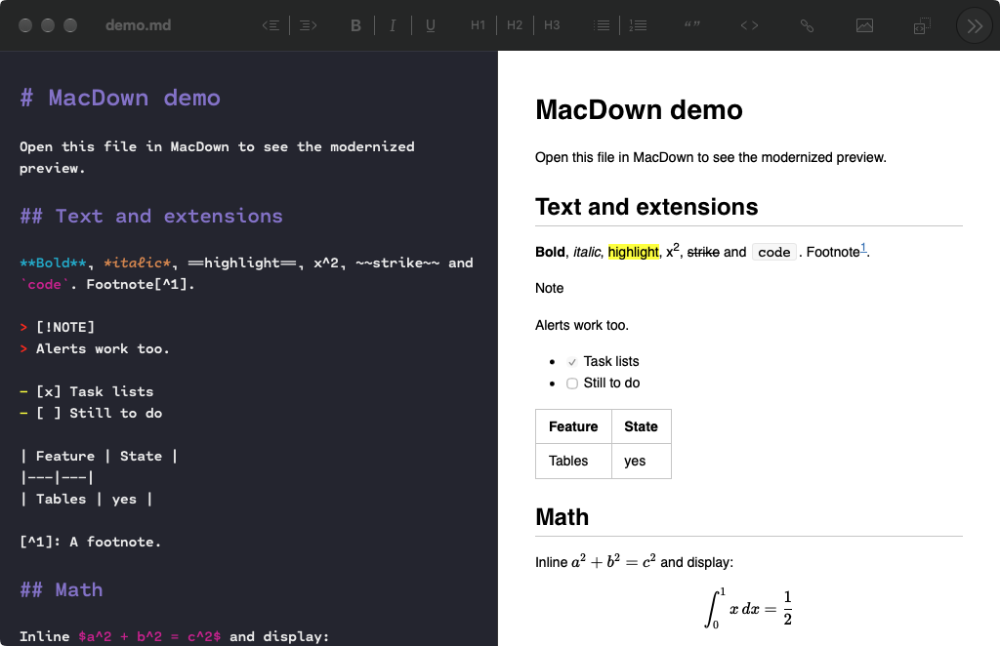
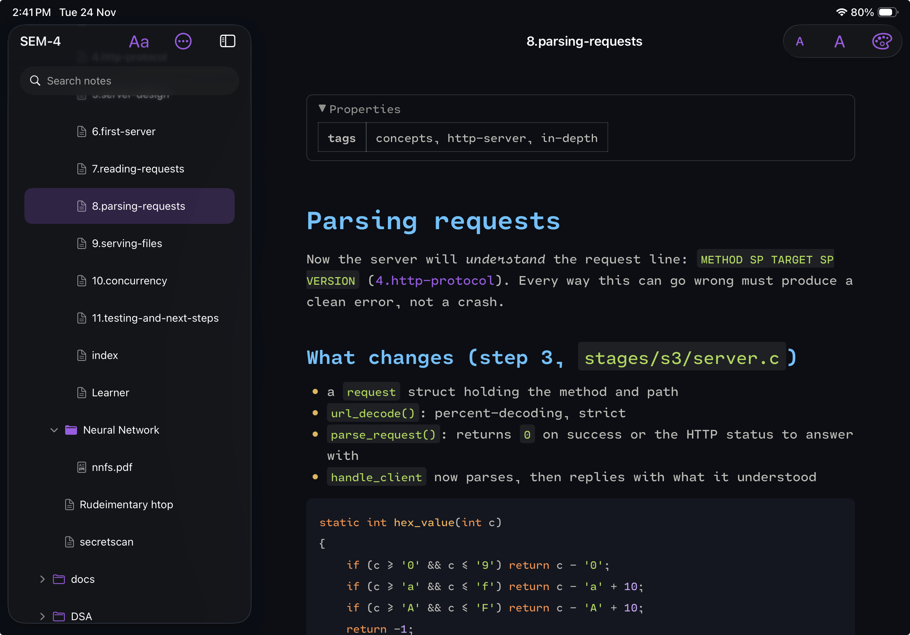
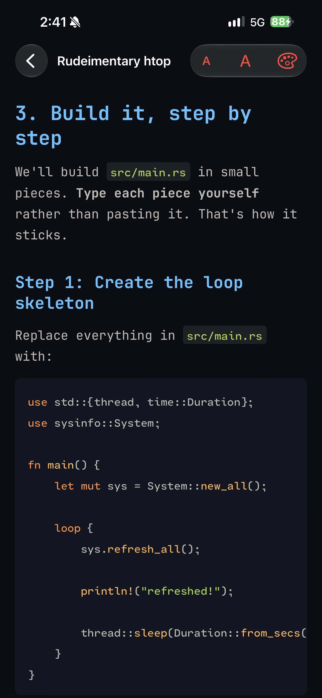
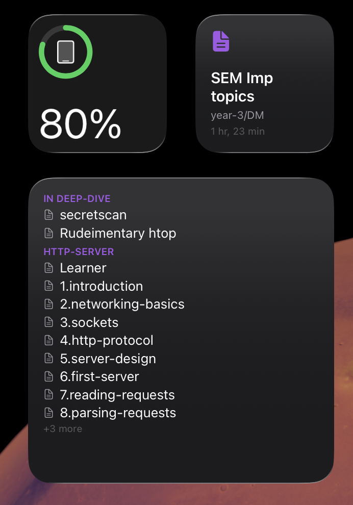

# MacDown

[](https://github.com/harshith-ashok/macdown/actions/workflows/ci.yml)
[](https://github.com/harshith-ashok/macdown/releases/latest)

[](LICENSE)

A fast, native Markdown editor for macOS with a live preview, plus a read-only vault viewer for iPhone and iPad.

## What is in this repository

| App | What it is | Relationship to MacDown |
| --- | --- | --- |
| **MacDown for macOS** (`MacDown/`) | Split-view Markdown editor: editor on the left, live preview on the right. Math (KaTeX), Mermaid and Vega-Lite diagrams, GitHub-style alerts, 19 YAML themes, custom fonts, a YAML config file. | **The only app based on the original [MacDown](https://github.com/MacDownApp/macdown)** by [Tzu-ping Chung (uranusjr)](https://github.com/uranusjr). It is a modernized fork: the Hoedown/`WebView` stack was replaced by cmark-gfm and `WKWebView`. |
| **MacDown for iPhone and iPad** (`Viewer/`) | Read-only viewer for an Obsidian vault in iCloud Drive: sidebar, PDFs, LaTeX, Mermaid, themes, fonts, accent colours and home screen widgets. | **Not a port.** It is a separate, newly written app that recreates MacDown's look, name, icon and themes. It shares no editor or rendering code with the original; only the theme and font definitions are shared with the Mac app. |
| **Widgets** (`Viewer/Widget/`) | Small, medium and large home screen widgets for the viewer. | Same as the viewer: an original recreation. |

If you want the original app, use [upstream MacDown](https://github.com/MacDownApp/macdown). This fork is not affiliated with it.

## Install

### macOS

Download `MacDown-<version>.zip` from the [latest release](https://github.com/harshith-ashok/macdown/releases/latest), unzip it and drag **MacDown.app** to Applications. The build is ad-hoc signed, not notarized, so the first time use right-click > Open, or run `xattr -dr com.apple.quarantine /Applications/MacDown.app`.

Or build it yourself, see [Development](#development).

### iPhone and iPad

Download `MacDown-<version>.ipa` from the [latest release](https://github.com/harshith-ashok/macdown/releases/latest). It is unsigned: sign and install it with your own Apple ID using Sideloadly or AltStore, or build and install straight from Xcode with `Tools/ipad/install.sh`. A free Apple ID's apps stop opening after 7 days. Details: [`Viewer/README.md`](Viewer/README.md).

## Screenshots

### macOS

Markdown editor on the left, live preview on the right.



### iPad and iPhone

A read-only viewer for Obsidian vaults in iCloud, with the same themes and fonts. See [`Viewer/README.md`](Viewer/README.md).



<p>
  
  &nbsp;
  
</p>

## Repository layout

```
MacDown/                macOS app (Objective-C + Swift)
  Code/                   Application, Document, Preferences, View, Extension, Utility (MP* classes)
  Code/Swift/             Config, Theme, Markdown, Preview, Lint, Git, Workspace, Editor (new Swift modules)
  Resources/              Styles, templates, themes, KaTeX, diagrams, fonts
  Localization/           Translations (Transifex)
MacDownTests/           XCTest unit, snapshot and integration tests for the macOS app
macdown-cmd/            Command-line launcher (`macdown file.md`)
Viewer/                 iPhone and iPad app
  Sources/ViewerCore/     Swift package: vault index, Obsidian syntax, rendering (no UI)
  App/  Widget/           SwiftUI app and WidgetKit widgets
  Tests/                  ViewerCore tests (`swift test`)
Dependency/             Git submodules (peg-markdown-highlight, version)
Tools/                  Build, release, font and project-generation scripts
  ipad/                   iOS project generator, .ipa build, device install, icon generator
docs/                   Roadmap (MODERNIZATION_PLAN.md), benchmarks, demo document
assets/                 README screenshots
.github/workflows/      CI and release
```

## License

MacDown is released under the terms of MIT License. You may find the content of the license [here](http://opensource.org/licenses/MIT), or inside the `LICENSE` directory.

You may find full text of licenses about third-party components in the `LICENSE` directory, or the **About MacDown** panel in the application.

The following editor themes and CSS files are extracted from [Mou](http://mouapp.com), courtesy of Chen Luo:

* Mou Fresh Air
* Mou Fresh Air+
* Mou Night
* Mou Night+
* Mou Paper
* Mou Paper+
* Tomorrow
* Tomorrow Blue
* Tomorrow+
* Writer
* Writer+
* Clearness
* Clearness Dark
* GitHub
* GitHub2

## Development

### Requirements

* macOS 13 or later, Xcode 27 (deployment target is macOS 13)
* Git
* [CocoaPods](https://cocoapods.org) (the system install is fine)

### Build the macOS app

```
git submodule update --init
pod install
make -C Dependency/peg-markdown-highlight
Tools/run.sh docs/demo.md        # builds Debug into ./build and opens the demo document
```

Open `MacDown.xcworkspace` (not the `.xcodeproj`) in Xcode. After pulling, re-run `git submodule update` and `pod install` if the build breaks. After adding or removing Swift files run `ruby Tools/sync_xcodeproj.rb`.

### Test

```
xcodebuild -workspace MacDown.xcworkspace -scheme MacDown -destination 'platform=macOS' test CODE_SIGNING_ALLOWED=NO
swift test --package-path Viewer      # ViewerCore, the iPhone/iPad logic
```

### Build the iPhone and iPad app

```
Tools/ipad/build-ipa.sh                 # unsigned build/ipad/MacDown.ipa
Tools/ipad/install.sh                   # signed build installed on a connected device
```

See [`Viewer/README.md`](Viewer/README.md) for signing and troubleshooting.

### Continuous integration and releases

* **CI** (`.github/workflows/ci.yml`) runs on every push and pull request: macOS app tests, ViewerCore tests, and an unsigned iOS build.
* **Release** (`.github/workflows/release.yml`) runs when you push a tag such as `v0.9.0`. It builds `MacDown-<version>.zip`, `MacDown-<version>.ipa` and `ViewerCore-<version>.tar.gz`, then publishes them as a GitHub Release with generated notes.

```
git tag v0.9.0 && git push origin v0.9.0
```

### Documentation

* [`CLAUDE.md`](CLAUDE.md): architecture notes
* [`docs/MODERNIZATION_PLAN.md`](docs/MODERNIZATION_PLAN.md): roadmap and status
* [`docs/benchmarks.md`](docs/benchmarks.md): performance budgets
* [`CONTRIBUTING.md`](CONTRIBUTING.md): contribution guidelines

### Translation

Translations are managed on [Transifex](https://www.transifex.com/macdown/macdown/).

## Credits

MacDown was created by [Tzu-ping Chung (uranusjr)](https://github.com/uranusjr) after [Chen Luo](https://twitter.com/chenluois)'s [Mou](http://mouapp.com). This fork builds on that work.

It relies on open source projects including [cmark-gfm](https://github.com/github/cmark-gfm) (Markdown), [Prism](https://prismjs.com) (code highlighting), [KaTeX](https://katex.org) (math), [Mermaid](https://mermaid.js.org) and [Vega-Lite](https://vega.github.io/vega-lite/) (diagrams), [Yams](https://github.com/jpsim/Yams) (YAML), [PEG Markdown Highlight](https://github.com/ali-rantakari/peg-markdown-highlight) (editor highlighting) and [JetBrains Mono](https://www.jetbrains.com/lp/mono/) (font, OFL).
