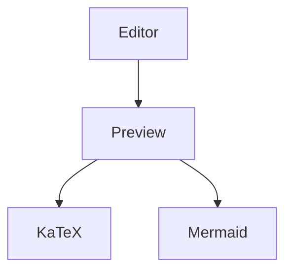

# MacDown demo

Open this file in MacDown to see the modernized preview.

## Text and extensions

**Bold**, *italic*, ==highlight==, x^2, ~~strike~~ and `code`. Footnote[^1].

> [!NOTE]
> Alerts work too.

- [x] Task lists
- [ ] Still to do

| Feature | State |
|---|---|
| Tables | yes |

[^1]: A footnote.

## Math

Inline $a^2 + b^2 = c^2$ and display:

$$\int_0^1 x\,dx = \frac{1}{2}$$

Currency stays text: it costs $5 and $10.

## Code

```swift
let greeting = "Hello"
```

## Mermaid



## Vega-Lite

```vega-lite
{"data": {"values": [{"a": "A", "b": 28}, {"a": "B", "b": 55}, {"a": "C", "b": 43}]},
 "mark": "bar",
 "encoding": {"x": {"field": "a", "type": "nominal"}, "y": {"field": "b", "type": "quantitative"}}}
```
